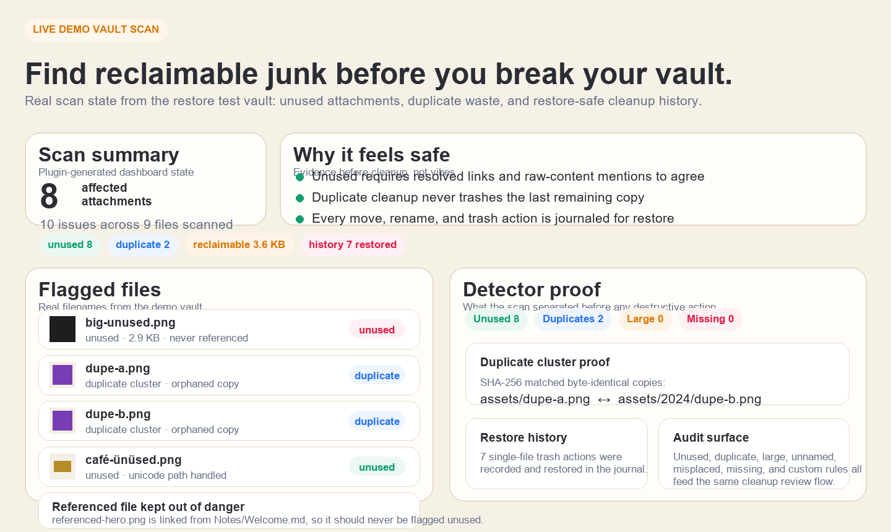

# Attachment Audit

**Safe attachment cleanup with evidence, not guesswork.**

Attachment Audit scans your vault for truly unused attachments, duplicates, oversized files, junk-named pastes, and misplaced files — then shows exactly what is reclaimable before you touch anything.

<!-- SCREENSHOT SLOT — drop a real Obsidian capture here to lift conversions.
     
     Suggested shot: the dashboard showing the reclaimable-space total and a few flagged files (unused / duplicate / large). Save as docs/assets/hero.png -->

Free lets you scan and clean one file at a time. Pro unlocks bulk cleanup, saved scan profiles, custom rules, severity tuning, and Markdown reports.

> Built for the moment when "I think these files are junk" is not good enough and you want evidence before you start deleting.

## Why Attachment Audit exists

Most attachment tools optimize for naming or filing. Useful, sure. But that is not the scary part.

The scary part is cleanup:
- which files are truly unused
- which ones are duplicated waste
- which giant files are eating your vault alive
- which ones can be moved or trashed safely

Attachment Audit exists to make that decision with evidence instead of vibes.

## What it finds

- **Unused** — attachments no note truly references
- **Duplicates** — byte-identical copies grouped with SHA-256, shown as one cluster with the recoverable total
- **Large files** — oversized attachments worth reviewing first
- **Poorly named** — junk like `Pasted image...`, `Screenshot...`, `IMG_1234`, or `Untitled`
- **Misplaced** — attachments living outside your chosen attachment folder
- **Broken links** — the inverse problem: links pointing at attachments that no longer exist, with the notes to fix

## Why it is safer than a generic orphan finder

Attachment Audit does not flag an attachment as unused from resolved Markdown links alone.

It cross-checks two independent signals:
- resolved links
- a raw-content mention scan across note bodies, frontmatter, canvas files, and around forty text formats — including `.txt`, `.tex`, `.json`, `.excalidraw`, SVG, HTML and CSS

It also reads Obsidian's own config folder, so an image used only by a CSS snippet or by another plugin's settings is not mistaken for junk.

That means a file referenced only in canvas, frontmatter, raw HTML, a LaTeX include, or a theme snippet is far less likely to be misclassified as trash.

It also keeps cleanup sane:
- nothing is hard-deleted
- moves and renames preserve links
- moves never flatten your subfolders
- duplicate cleanup only removes copies nothing links to, and never trashes every copy
- destructive actions re-validate before acting, and show you exactly which files they will touch
- if any source file cannot be read, nothing is flagged unused that run
- **everything it changes is recorded, and you can put it back**

## Cleanup history

Every trash, move and rename is recorded: which files, from where, to where, and when. Open it from the dashboard, the command palette, or settings — and click once to put a whole action back.

Restoring is **free at any size**. Pro is for doing cleanup at scale; recovering from cleanup is safety, not scale.

It is also honest about what it cannot do. Only files sent to the vault's `.trash` folder can be restored by a plugin:

| Your "Deleted files" setting | Can Attachment Audit restore it? |
| --- | --- |
| Move to Obsidian trash (`.trash`) | Yes, in one click |
| Move to system trash | No — it tells you to restore from there |
| Permanently delete | No, and it says so before you confirm |

Where a trashed file went is recorded at the moment of the action, so changing that setting later can never make the history offer a restore that would not work. Moves and renames are always reversible, and reversing one re-updates every link it changed.

## Free vs Pro

Free is a complete audit tool. Pro is for *changing* many files at once.

| Feature | Free | Pro |
| --- | :---: | :---: |
| All six detectors | ✓ | ✓ |
| Dashboard with reclaimable-space total | ✓ | ✓ |
| Image previews and duplicate grouping | ✓ | ✓ |
| One-file-at-a-time cleanup | ✓ | ✓ |
| Open / reveal / rename / ignore / exclude / mark reviewed | ✓ | ✓ |
| Per-detector thresholds and exclusions | ✓ | ✓ |
| Multi-select, bulk ignore and bulk mark-reviewed | ✓ | ✓ |
| Markdown report export | ✓ | ✓ |
| Cleanup history and restore | ✓ | ✓ |
| Your first bulk cleanup | ✓ | ✓ |
| Unlimited bulk trash, dedupe and move |  | ✓ |
| Saved scan profiles |  | ✓ |
| Custom rules |  | ✓ |
| Severity tuning |  | ✓ |

Purchase: [Buy Me a Coffee — Attachment Audit Pro](https://buymeacoffee.com/vaultspotlight/e/560207). License keys are verified **offline** (Ed25519) — no account, server, or subscription.

**Activate Pro**

1. Purchase via [Buy Me a Coffee — Attachment Audit Pro](https://buymeacoffee.com/vaultspotlight/e/560207).
2. Your license key is emailed to you **automatically, within seconds** — delivery is fully automated, no waiting.
3. Paste it into the plugin's settings — Pro unlocks instantly, verified offline.

## Install

**Community plugins**

Open **Settings → Community plugins**, search **Attachment Audit**, and install it — one click, auto-updates.

**Manual install**

Copy `main.js`, `manifest.json`, and `styles.css` into `.obsidian/plugins/attachment-audit/` in your vault, then enable the plugin.

## Getting started

1. Run **Attachment Audit: Run attachment scan** from the command palette.
2. Optionally set an attachment folder to enable misplaced-file checks and one-click moves.
3. Review the reclaimable-space summary and work through the flagged files.

## Safety

Attachment Audit touches files, so safety is the whole business model:

- trash respects your Obsidian deleted-files setting
- "unused" requires two signals to agree
- duplicate cleanup keeps at least one copy and never touches a referenced file — see [How duplicate cleanup decides](#how-duplicate-cleanup-decides)
- moves and renames use Obsidian's link-updating rename flow
- every destructive action confirms and re-checks before acting

## How duplicate cleanup decides

**"Trash duplicate copies" is not a merge action.** It never rewrites a link, because it never trashes a file that anything links to. That is the whole design: declining to delete a file is safe, silently repointing links is not.

A duplicate copy is trashed only if **all** of these hold:

1. **It is selected.** Unselected copies are never touched.
2. **The same scan flagged it Unused** — the two-signal check: no note resolves a link to it, *and* its filename appears nowhere in any note body, frontmatter field, canvas, or other text source. Both signals have to agree.
3. **It still has zero inbound references at the moment you click.** Re-checked live, per file, immediately before trashing.

So for a set of byte-identical copies:

| Your cluster | What happens |
| --- | --- |
| One copy linked, the rest orphaned | The orphans are trashed. The linked copy survives — it was never eligible. |
| Every copy is orphaned | One copy is kept and the rest are trashed. You never lose the content. |
| Two or more copies are linked | **Nothing is trashed.** You get a notice: "no safely-removable duplicate copies (all are referenced or would be the last copy)." |

There is no "smart" choice of which copy is better. Linked copies survive because they are ineligible, not because they were preferred. In the all-orphaned case the survivor is simply the first in the current list order — so **if you care which specific file survives, deselect it before running the action.**

**To actually merge two linked duplicates:** search your vault for the filename of the copy you want to lose, repoint those links at the copy you want to keep, then rescan. The loser is now Unused and can be trashed normally. Automatic cross-duplicate repointing is not implemented, and will not ship until it can't corrupt a vault.

Related: **Move** and **Rename** *do* update links — Markdown links, wikilinks, and canvas references, via Obsidian's own link-updating rename. They do not rewrite raw HTML `` or path strings stored in frontmatter. Duplicate cleanup needs none of this, since it only ever removes files nothing points at.

## Pro

Attachment Audit Pro uses an offline license key.

- one-time payment
- no account required
- no always-online checks
- validated locally in your vault

Pro is for people who want to reclaim space in batches instead of babysitting one file at a time.

## Buy Pro

Attachment Audit Pro uses an offline license key and a one-time payment.

**Buy Attachment Audit Pro — $9 one-time:** https://buymeacoffee.com/vaultspotlight/e/560207

What you get:
- bulk cleanup across many files
- saved scan profiles
- custom rules
- severity tuning
- Markdown report export

Delivery model:
- one-time purchase
- no account required
- offline license verification
- license key delivered automatically by email, in seconds

## Privacy

Everything runs locally in your vault.

- no network calls
- no telemetry
- no account
- offline license validation

## Pricing

- **Free** — full audit plus one-file-at-a-time cleanup
- **Pro — $9 one-time** — bulk cleanup, saved profiles, custom rules, severity tuning, and Markdown report export

## FAQ

**Why not just use a free orphan finder?**
Because "lists possible orphans" and "safe enough to bulk-delete" are not the same thing.

**If I trash a duplicate, will links to it break?**
No. "Trash duplicate copies" only removes copies that nothing links to, so there is nothing to break and nothing to repoint. If two duplicates are both linked, neither is trashed. See [How duplicate cleanup decides](#how-duplicate-cleanup-decides).

**Does Pro require an account?**
No. Pro uses a one-time offline license key.

**Does Attachment Audit upload my files anywhere?**
No. It runs locally in your vault.

## Support

Open an issue at [github.com/israerusan/attachment-audit](https://github.com/israerusan/attachment-audit/issues).
